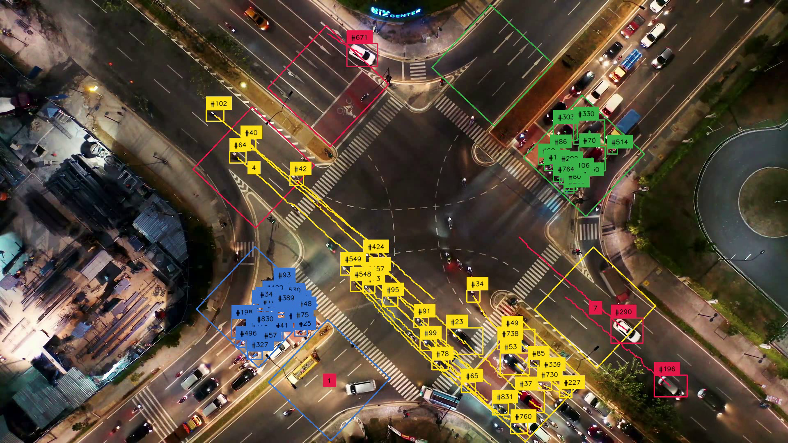

# Vehicle Tracking, Counting & Direction Detection

Detect, track and count vehicles in aerial intersection footage, and work out
**where each vehicle came from and where it went**.

Detection runs on **YOLOv8** (local weights) or a hosted **Roboflow** model.
Tracking uses **ByteTrack**, and zones and drawing use
[Supervision](https://github.com/roboflow/supervision).



---

## How it works

```
video frame ──► detector (YOLO / Roboflow, optionally tiled) ──► ByteTrack
            ──► zone logic (flow or occupancy) ──► annotated frame ──► .mp4 / window
```

The intersection has **four roads**. Each road has an **entry zone** and an
**exit zone**, and each road has its own colour (red, green, yellow, blue).

1. A tracked vehicle is tagged with the **first entry zone** it passes through.
   That zone is its origin, and its box and trail are drawn in that road's colour.
2. When the vehicle later reaches an **exit zone**, it is counted under
   `exit zone ← origin road`. Each tracker ID is counted once.
3. Next to every exit zone, one coloured number is drawn per origin road. So a
   red `3` next to the green exit means *3 vehicles came from the red road and
   left through the green road*.

Two analysis modes are available:

| Mode | What it counts |
|------|----------------|
| `flow` (default) | Vehicles per *origin road → exit road*. This is the direction analysis described above. Add `--dashboard` to draw a North / East / South / West summary box in each corner. |
| `occupancy` | Vehicles currently inside one central zone, plus the total number of distinct vehicles that entered it. |

---

## Project structure

```
.
├── vehicle_tracking/          # Main package
│   ├── __main__.py            # CLI: python -m vehicle_tracking ...
│   ├── config.py              # Zone polygons, colours, direction names
│   ├── detectors.py           # YOLO / Roboflow backends + InferenceSlicer wrapper
│   ├── counting.py            # FlowCounter (entry→exit) & OccupancyCounter
│   ├── annotation.py          # Drawing: boxes, traces, zone counts, dashboard
│   └── processor.py           # VideoProcessor: detect → track → count → draw
├── scripts/
│   ├── download_files.sh      # Downloads sample videos + trained weights into data/
│   └── detect_image.py        # Run detection on a single image
├── assets/
│   └── demo_frame.png         # Example output
├── data/                      # (created by download_files.sh, git-ignored)
└── requirements.txt
```

---

## Installation

**Requirements:** Python 3.10+.

```bash
# 1. Clone
git clone https://github.com/<your-username>/VehicleTrackingCountingDirection.git
cd VehicleTrackingCountingDirection

# 2. Create and activate a virtual environment
python3 -m venv venv
source venv/bin/activate          # Windows: venv\Scripts\activate

# 3. Install dependencies
pip install -r requirements.txt

# 4. Download the sample videos and trained YOLO weights into ./data
./scripts/download_files.sh
```

After step 4, `data/` contains:

| File | Description |
|------|-------------|
| `vehiclesTraffic1.mp4` | Sample intersection video |
| `vehiclesTraffic2.mov` | Sample intersection video |
| `vehiclesTraffic.pt` | YOLOv8 weights trained for aerial vehicles |
| `vehiclesTraffic_overtrained.pt` | Alternative weights (trained for longer) |

> The `inference` package is only needed for the Roboflow backend. If you only
> use YOLO, you can remove it from `requirements.txt`.

---

## Usage

All processing goes through one command:

```bash
python -m vehicle_tracking --source_video_path <video> [options]
```

If you leave out `--target_video_path`, frames are shown live in a window. Press
**q** to quit.

### Examples

**YOLO, save to file**
```bash
python -m vehicle_tracking \
    --backend yolo \
    --weights data/vehiclesTraffic.pt \
    --source_video_path data/vehiclesTraffic1.mp4 \
    --target_video_path output_video.mp4
```

**YOLO + slicer** (tiles each frame into 640×640 patches; much better for small
or distant vehicles in 4K footage, but slower)
```bash
python -m vehicle_tracking --backend yolo --weights data/vehiclesTraffic.pt \
    --source_video_path data/vehiclesTraffic1.mp4 \
    --target_video_path output_video.mp4 --slicer
```

**Direction dashboard** (adds North/East/South/West count boxes in the corners)
```bash
python -m vehicle_tracking --backend yolo --weights data/vehiclesTraffic.pt \
    --source_video_path data/vehiclesTraffic1.mp4 --dashboard
```

**Roboflow hosted model**
```bash
export ROBOFLOW_API_KEY=your_key_here
python -m vehicle_tracking \
    --backend roboflow --model_id skyview-vehicle/4 \
    --source_video_path data/vehiclesTraffic1.mp4 \
    --target_video_path output_video.mp4
```

**Occupancy mode** (vehicles inside the central zone)
```bash
python -m vehicle_tracking --weights data/vehiclesTraffic.pt \
    --source_video_path data/vehiclesTraffic1.mp4 --mode occupancy
```

**Single image** (quick model or threshold check)
```bash
python scripts/detect_image.py --image frame.jpg \
    --backend yolo --weights data/vehiclesTraffic.pt --output processed_frame.png
```

### All options

| Option | Default | Description |
|--------|---------|-------------|
| `--source_video_path` | *required* | Input video |
| `--target_video_path` | none | Output `.mp4`. If omitted, a live preview window is shown |
| `--backend` | `yolo` | `yolo` or `roboflow` |
| `--weights` | none | YOLO `.pt` weights (required for `yolo`) |
| `--model_id` | `skyview-vehicle/4` | Roboflow model ID (e.g. `cars-jnnoy/1`) |
| `--roboflow_api_key` | `$ROBOFLOW_API_KEY` | Roboflow API key |
| `--confidence_threshold` | `0.3` | Minimum detection confidence |
| `--iou_threshold` | `0.7` | NMS IoU threshold |
| `--slicer` | off | Run detection on tiles (SAHI-style) |
| `--slice_size` | `640` | Tile size used with `--slicer` |
| `--mode` | `flow` | `flow` (entry→exit counting) or `occupancy` |
| `--dashboard` | off | Corner direction boxes (flow mode) |

---

## Configuring zones for your own video

Zones are defined in [`vehicle_tracking/config.py`](vehicle_tracking/config.py):

- `ZONE_IN_POLYGONS` / `ZONE_OUT_POLYGONS`: four entry and four exit polygons
  for flow mode. List index *i* is road *i*, and its colour is `COLORS[i]`.
- `OCCUPANCY_POLYGON`: the single zone used by occupancy mode.
- `DIRECTIONS`: the dashboard labels, in the same order as the exit zones.

Polygons are written in the pixel coordinates of a reference resolution
(`FLOW_REFERENCE_WH`, `OCCUPANCY_REFERENCE_WH`) and are **rescaled
automatically** to the input video's resolution. The same zones therefore work
for both 1080p and 4K versions of the footage.

For a different camera or intersection, draw new polygons (for example with
Roboflow's [PolygonZone tool](https://polygonzone.roboflow.com/)) and set the
matching reference resolution.

---

## Using it from Python

```python
from vehicle_tracking import VideoProcessor, build_detector

detector = build_detector("yolo", weights_path="data/vehiclesTraffic.pt", slicer=True)
processor = VideoProcessor(detector, "data/vehiclesTraffic1.mp4", "out.mp4", dashboard=True)
processor.process_video()

# counts[exit_zone][origin_zone] -> set of tracker IDs
print(processor.flow_counter.counts)
```

---

## Notes & troubleshooting

- **`supervision` version:** `sv.ByteTrack` was removed in supervision 0.31, so
  `requirements.txt` pins `supervision<0.31`. You may see a deprecation warning
  about `ByteTrack`. It is harmless.
- **GPU:** Ultralytics uses CUDA or Apple MPS automatically when available.
- **Missed small vehicles:** try `--slicer` and/or a lower `--confidence_threshold`.
- **Headless servers:** always pass `--target_video_path`, because the preview
  window needs a display.

---

## Acknowledgements

- [Ultralytics YOLOv8](https://github.com/ultralytics/ultralytics): object detection
- [ByteTrack](https://github.com/ifzhang/ByteTrack): multi-object tracking
- [Roboflow Supervision](https://github.com/roboflow/supervision) & [Inference](https://github.com/roboflow/inference): zones, annotation, hosted models
